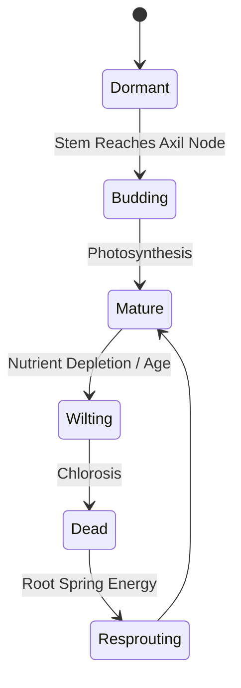

# Procedural ASCII Graphics & Generative Glyph Botany

This skill teaches how to render living, procedural, animated, and interactive graphics using ASCII and Unicode symbols.

Instead of traditional ASCII art—which treats characters as coarse pixels approximating static pre-baked bitmaps—this system models graphics as **continuous vector strokes, polar curves, and living organs**, using characters as directional brushstrokes, anatomical boundaries, and light emitters.

```
       .      .   .   .  .
    .   \   /   .   /   .   .
     \   %#%   /   /  .
  .---  #*8*#  ---.       .  '
     /   %#%   \   \  .
    '   /   \   '   \   '   '
       '      '   '   '  '
              \v/
              +!+
              !|!
          {-( !|! )-}
              !|!
            ~/ | \~
           ~/  |  \~
          (    |    )
         ~~~~~---~~~~~
```

---

## 1. The Core Philosophy: Vector Strokes, Not Pixel Blocks

Traditional ASCII art treats characters as a fixed grid of brightness values (`@%#*+=-:. `). While suitable for converting JPEG images to text, it produces rigid, lifeless results.

**The Procedural ASCII Philosophy:**
1. **Characters are Vector Brushstrokes**: A character is chosen because its geometry mirrors the curve's local tangent vector, curvature, or organ function.
2. **Zero Pre-Baked Art**: No static ASCII templates. Stems, petals, leaves, and teeth are synthesized in real time from mathematical functions.
3. **Continuous Coordinates with Subpixel Rotation**: In HTML5 Canvas, characters are placed at floating-point world coordinates and rotated to match the local curve derivative $\theta = \operatorname{atan2}(dy, dx)$.
4. **Organic Life-Cycle State Machines**: Objects aren't static loops; they are born with heritable genetic code, grow via continuous logistic equations, blossom, hold mature prime plateaus for extended durations ($20n$), wilt organically, set seed, and die.

---

## 2. The Rotated Glyph Language

Every character has geometric and structural traits. Match characters to their physical and anatomical roles:

| Anatomical Role | Glyph Vocabulary | Selection Rule / Geometry |
| :--- | :--- | :--- |
| **Stem Apex / Sprout** | `.`, `'`, `,`, `^`, `!` | Low mass, thin tip, beginning of shoot elongation |
| **Stem Backbone** | `\|`, `!`, `(`, `)`, `/`, `\` | Directional stroke matching tangent angle $\theta$ |
| **Lignified Base** | `#`, `%`, `&`, `8`, `O` | High visual weight, dense fiber packing near soil |
| **Nodes & Axils** | `+`, `*`, `%`, `#`, `&` | Junction points where shoots, leaves, and branches diverge |
| **Branch Shoots** | `/`, `\`, `(`, `)`, `+`, `~` | Bilateral divergence from nodes ($+1$ right, $-1$ left) |
| **Leaves / Foliage** | `{`, `}`, `(`, `)`, `~`, `v`, `^`, `>` | Curved enclosing brackets forming leaf blades and tips |
| **Calyx / Sepals** | `\v/`, `\w/`, `\Y/`, `(Y)`, `\|/` | Cup-shaped brackets holding the base of the flower head |
| **Ray Petals** | `%`, `8`, `@`, `O`, `&`, `*`, `c`, `s` | Radial lobes distributed around polar angle $\theta$ |
| **Disc Florets / Heart** | `#`, `*`, `&`, `8`, `o`, `.` | Dense phyllotaxis spiral lattice strictly bounded within petals |
| **Marginal Cilia / Teeth**| `\|`, `/`, `\`, `^`, `v`, `!` | Spines along contour edges (e.g. Venus flytrap jaws, thistle) |
| **Seed Pappus / Parachute**| `✦`, `*`, `+`, `.` | Lightweight radial stars designed to detach and drift on wind vectors |

> [!IMPORTANT]
> **Sunflower Seed Disc Containment Rule:**
> When drawing composite flowers (sunflowers, daisies, asters), disc florets ($r_{\text{disc}} = c \sqrt{i}$) must be strictly bounded within the inner perimeter of the ray petals:
> $$r_{\text{disc}} \le R_{\text{petal\_inner}} - \delta$$
> Never let seed florets bleed outside the petal ring.

---

## 3. Continuous Mathematical Botany

Procedural characters should be positioned using continuous mathematical formulations:

### A. Logistic Growth Kinetics
Stems elongate smoothly without sudden visual popping:
$$L(t) = L_{\max} \cdot \frac{1 - e^{-k t}}{1 - e^{-k}}$$
- $t \in [0, 1]$: Normalized biological vegetative age.
- $k \approx 4.0$: Steepness coefficient producing rapid initial juvenile growth tapering into steady adult maturity.

### B. Polar Coordinate Petal Lobes
Petal perimeters follow polar rose harmonics:
$$r(\theta) = R_{\text{base}} + A \cdot \cos(k \theta)$$
- $k = 5$ or $7$: Rose, hibiscus, mallow
- $k = 6$: Star tepals (daffodil, lily)
- $k = 16$ or $24$: Sunflower, daisy, aster

Multi-layered rosettes evaluate multiple concentric passes with angular phase offsets $\Delta \theta = \frac{\pi}{k}$.

### C. Sunflower Phyllotaxis (Golden Ratio Spiraling)
For seed heads and compact succulent rosettes, place seeds using the Golden Angle ($137.507764^\circ \approx 2.399963\text{ rad}$):
$$r_i = c \sqrt{i}, \quad \theta_i = i \times 137.507764^\circ$$
Select dense glyphs (`#`, `*`, `&`, `8`) near the center and lighter florets (`o`, `.`) near the perimeter.

### D. Harmonic Euler Wind Kinematics
Create natural swaying by superimposing sinusoidal traveling waves with power-law height scaling:
$$W(y, x, t) = \sum_{m=1}^3 A_m \sin(\omega_m t + k_m y - c_m x) \cdot \left(\frac{y}{H}\right)^{1.4}$$
- The exponent $1.4$ anchors the roots rigidly at $y=0$ while flexing the apex.
- The spatial offset $-c_m x$ causes gusts to visibly roll across a field from left to right.

### E. Pointer Heliotropism / Phototropism
Stems naturally reach towards light sources (cursor or touch point) using inverse kinematics with elastic restoring tension:
$$\Delta \theta_{\text{light}} = \kappa \cdot \operatorname{atan2}(x_{\text{pointer}} - x_{\text{apex}}, y_{\text{pointer}} - y_{\text{apex}}) \cdot \frac{1}{1 + \frac{d^2}{R_{\text{reach}}^2}}$$

---

## 4. Biological Lifecycles & State Machines

Never let plants snap into existence or die all at once. Implement a multi-tiered lifecycle system:

### A. The 20n Mature Prime Plateau
If a plant takes $n$ time units (e.g. 30 seconds or 24 hours) to grow from seedling to full bloom, it **must remain at full height in prime bloom for at least $20n$ duration** before initiating any senescence.
- Age $[0.0, 1.0]$: Vegetative elongation, bud formation, petal anthesis.
- Age $[1.0, 21.0]$: The $20n$ Mature Prime Plateau (continuous flowering, breeze swaying, zero browning).
- Age $[21.0, 23.0]$: Natural senescence (chlorophyll breakdown, seed dispersal).
- Age $> 23.0$: Soil decomposition, triggering a generational reseed.

### B. Member Subcycles & Dependency Graphs
Every organ has its own subcycle:


**The Branch Dependency Rule:**
An axillary branch must never wither prematurely. A branch enters senescence and dies **if and only if all flowers and all leaves attached to that branch are already dead**.

### C. Heritable Genomes & Reseeding Diversity
When a plant finishes its lifecycle, it drops seeds that sprout new plants. The new plant must **not** be a clone. Derive its parameters from a heritable genome with Gaussian mutation:
```javascript
const childGenome = {
  vigor: parent.vigor * (1.0 + (Math.random() - 0.5) * 0.15),
  maxHeight: parent.maxHeight * (1.0 + (Math.random() - 0.5) * 0.12),
  curvature: parent.curvature + (Math.random() - 0.5) * 0.20,
  branchingTendency: Math.max(0.2, parent.branchingTendency + (Math.random() - 0.5) * 0.1),
  petalHueShift: parent.petalHueShift + (Math.random() - 0.5) * 0.08
};
```

---

## 5. Rendering Pipeline & Visual Engineering

### A. HTML5 Canvas: Subpixel Rotated Glyphs
For smooth 60 FPS animation on desktop and mobile:
```javascript
function drawRotatedGlyph(ctx, char, x, y, angle, color, fontSize = 14, fontFamily = 'JetBrains Mono, monospace') {
  ctx.save();
  ctx.translate(x, y);
  ctx.rotate(angle);
  ctx.font = `bold ${fontSize}px ${fontFamily}`;
  ctx.fillStyle = color;
  ctx.textAlign = 'center';
  ctx.textBaseline = 'middle';
  ctx.fillText(char, 0, 0);
  ctx.restore();
}
```

### B. Dual-Pass Hardware Screen-Space Bloom
ASCII symbols glow with a neon phosphor aesthetic without expensive post-processing shaders:
```javascript
function renderWithBloom(ctx, renderCallback) {
  // Pass 1: Background glow layer
  ctx.save();
  ctx.filter = 'blur(6px)';
  ctx.globalAlpha = 0.45;
  renderCallback(ctx);
  ctx.restore();

  // Pass 2: Foreground crisp glyph layer
  ctx.save();
  ctx.globalAlpha = 1.0;
  renderCallback(ctx);
  ctx.restore();
}
```

### C. High-DPI Mobile Performance Rule
Modern smartphones have $3\times$ pixel ratios. Always clamp DPR to 2.0 to avoid mobile GPU fillrate collapse:
```javascript
const dpr = Math.min(2.0, window.devicePixelRatio || 1);
canvas.width = cssWidth * dpr;
canvas.height = cssHeight * dpr;
ctx.scale(dpr, dpr);
```

### D. Bottom-Up Senescence Palette Shifting
Tissue browns from the root upward. Compute senescence as a function of height fraction:
$$\text{chlorosis}(y) = \operatorname{clamp}\left(\frac{\text{plantAge} - 21.0}{2.0} - \frac{y}{H} \cdot 0.8, 0, 1\right)$$
Interpolate colors from vibrant emerald (`#55e64b`) $\to$ golden yellow (`#ffbe28`) $\to$ autumn brown (`#8d6e63`).

---

## 6. Zero-DOM Terminal String Grid Mode

For CLI tools, terminal dashboards, and text art, render onto a 2D spatial text buffer:

1. **Aspect Ratio Compensation**: Terminal character cells are typically twice as tall as they are wide ($1:2$ aspect ratio). Scale horizontal coordinates by $2.0$ to prevent circles from flattening into ellipses:
   $$x_{\text{grid}} = \lfloor x_{\text{world}} \times 2.0 \rfloor, \quad y_{\text{grid}} = \lfloor y_{\text{world}} \rfloor$$
2. **Buffer Painting Order (Painter's Algorithm)**:
   - Layer 0: Soil line and ambient grass (`.`, `,`, `"`, `~`)
   - Layer 1: Stem backbone (`|`, `/`, `\`)
   - Layer 2: Axillary branches and leaves (`{`, `}`, `~`)
   - Layer 3: Flowers, petals, and seed discs (`%`, `#`, `@`, `*`)
   - Layer 4: Floating dandelion parachute seeds (`✦`, `+`)
3. **ANSI 24-Bit Color Serialization**:
   Wrap characters in ANSI sequences: `\x1b[38;2;R;G;Bm<char>\x1b[0m`.

---

## 7. Complete Reference Map

For detailed guides and code implementations, explore the reference files:

- **[Glyph Language Guide](./references/glyph-language.md)**: Deep dive into character geometry, directional angle quantization, and anatomical vocabularies.
- **[Math & Physics Engine](./references/math-and-physics.md)**: Mathematical formulas for logistic growth, polar rosettes, Euler harmonic waves, and inverse kinematics.
- **[Rendering & Bloom Pipeline](./references/rendering-and-bloom.md)**: Canvas matrix rotations, dual-pass glow, touch optimization, and terminal buffer rasterizers.
- **[Botany & Life Cycles](./references/botany-and-lifecycles.md)**: State machines, 20n plateaus, branch dependency rules, and genetic mutation models.
- **[Minimal Canvas Plant Example](./examples/minimal-canvas-plant.html)**: Standalone single-file HTML animated ASCII blooming flower.
- **[Terminal Botany CLI Example](./examples/terminal-tree.js)**: Standalone zero-dependency Node.js script generating organic ASCII plants in terminal standard output.
