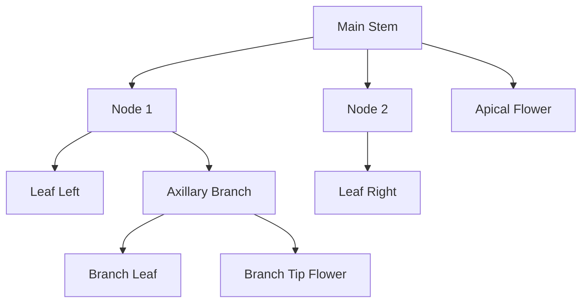

# Botany, Biological Lifecycles & State Machines

A procedural botanical simulation is only convincing if plants behave as mortal, evolving biological entities. This reference documents lifecycle state machines, member subcycles, branch dependency trees, and deterministic time-anchored simulation.

---

## 1. The Multi-Phase Plant Lifecycle

A common failure mode in generative art is creating plants that bloom instantaneously and die abruptly. Biological specimens follow distinct developmental epochs:

```
  0.0                                1.0                               21.0           23.0+
   |----------------------------------|----------------------------------|--------------|--->
   ^ Sprout -> Vegetative -> Anthesis ^    The 20n Mature Prime Plateau   ^  Senescence  ^ Decomp/
   |     Growth Phase (n cycles)      |       Flowering Prime (20n)      | & Seed Drop  | Reseed
```

### The 20n Rule
If a specimen takes $n$ units of time to achieve full height and blossom anthesis, **it must remain in mature flowering prime for at least $20n$ units of time**.
- During $[1.0, 21.0]$, senescence factor is strictly $0.0$.
- Flowers stay in full glory, stems sway in the breeze, and leaves perform photosynthesis.
- Senescence only begins when age crosses $21.0$.

---

## 2. Member Subcycles & Dependency Graphs

A plant is not a monolithic object; it is an ecosystem of semi-autonomous organs (stem, branches, leaves, calyxes, flowers, and seed heads).



### The Branch Dependency Invariant
An axillary branch must never wither while its progeny are alive. The state transition rule for any branch is:

$$\text{CanBranchDie} = \left(\forall l \in \text{Leaves}_{\text{branch}}, \text{state}(l) = \text{DEAD}\right) \land \left(\forall f \in \text{Flowers}_{\text{branch}}, \text{state}(f) = \text{DEAD}\right)$$

If even one leaf or flower on a branch is alive, the branch continues to receive vascular nourishment and remains green and active.

### Leaf Subcycle State Machine
Individual leaves emerge as tiny nascent buds, expand smoothly, mature, undergo nutrient depletion, and drop:

1. **DORMANT**: Node has not yet emerged from soil.
2. **BUDDING** ($\text{leafAge} \in [0.0, 0.3]$): Tiny nascent bud (`.`, `,`), scaling smoothly from $0.15\times$ to $1.0\times$ size (zero popping).
3. **MATURE** ($\text{leafAge} \in [0.3, 0.7]$): Full expansion (`{-(` or `)-}`), maximum green photosynthesis.
4. **WILTING** ($\text{leafAge} \in [0.7, 0.95]$): Yellowing chlorosis, downward drooping angle.
5. **DEAD** ($\text{leafAge} \ge 0.95$): Detaches and falls to soil.
6. **RESPROUTING**: If the parent plant is still in its $20n$ prime plateau, dormant axil meristems have a $15\%$ chance to produce a fresh juvenile leaf to replenish the canopy.

---

## 3. Reseeding & Heritable Genetic Variation

When a mature plant reaches the end of its life, it drops seeds that sprout the next generation. The replacement plant must never be a visual clone. Instead, seeds inherit a perturbed genome:

```javascript
class PlantGenome {
  constructor(parent = null) {
    if (!parent) {
      // Wildtype baseline
      this.vigor = 1.0;
      this.maxHeight = 320;
      this.curvature = 0.15;
      this.branchingTendency = 0.8;
      this.petalHue = 45; // Golden
      this.leafDensity = 1.0;
    } else {
      // Inherited traits with Gaussian drift
      const drift = (mag) => (Math.random() - 0.5) * 2 * mag;
      this.vigor = Math.max(0.6, Math.min(1.4, parent.vigor + drift(0.12)));
      this.maxHeight = Math.max(220, Math.min(460, parent.maxHeight + drift(35)));
      this.curvature = Math.max(-0.6, Math.min(0.6, parent.curvature + drift(0.15)));
      this.branchingTendency = Math.max(0.2, Math.min(1.5, parent.branchingTendency + drift(0.15)));
      this.petalHue = (parent.petalHue + drift(12) + 360) % 360;
      this.leafDensity = Math.max(0.5, Math.min(1.8, parent.leafDensity + drift(0.15)));
    }
  }
}
```

---

## 4. Deterministic Time-Anchored State ($t_0$ Epoch)

A powerful capability of procedural math is calculating the exact state of a garden after hours, days, or months without running millions of frames in a simulation loop.

Given:
- $t_0$: Timestamp when the garden was sown (in milliseconds).
- $t_{\text{now}}$: Current time (in milliseconds).
- $S$: Speed preset (e.g. `'24h'` where $1$ biological cycle $= 24\text{ hours} = 86,400,000\text{ms}$).

### Calculating Plant Age at Time $t$:
$$\Delta t_{\text{elapsed}} = t_{\text{now}} - t_0$$
$$\text{cyclesElapsed} = \frac{\Delta t_{\text{elapsed}}}{\text{cycleDuration}}$$
$$\text{generation} = \lfloor \text{cyclesElapsed} \rfloor$$
$$\text{currentPlantAge} = \text{cyclesElapsed} - \text{generation}$$

### Deterministic Seed Derivation:
To ensure the plant's architecture (branches, leaf count, petal shapes) is completely deterministic across page reloads:
$$\text{seed}_{\text{gen}} = \operatorname{hash}(\text{masterSeed}, \text{plantIndex}, \text{generation})$$

Any user visiting the page 12 hours later will see the identical plants half-grown in active bloom; visiting 3 days later will show the flourishing prime plateau; visiting next month will reveal the 3rd or 4th generation of descendants that organically germinated in that spot.
