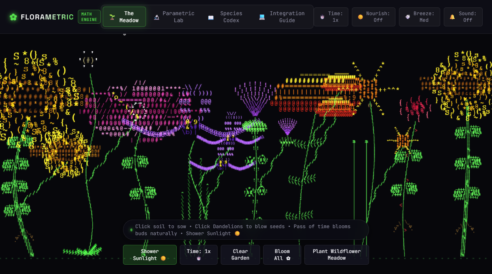
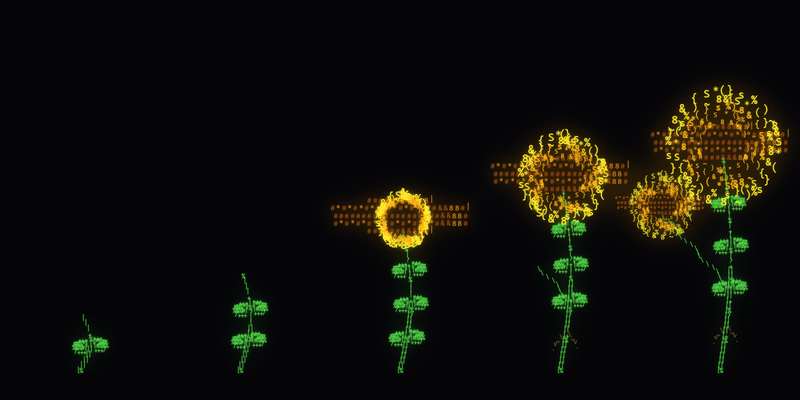
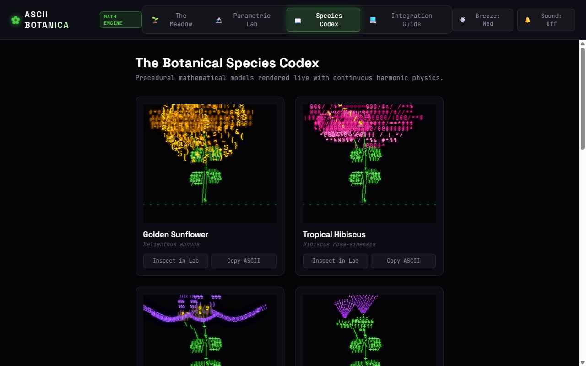

# ✿ Florametric

[](https://opensource.org/licenses/MIT)
[-success.svg)](florametric.js)
[-blue.svg)](#performance--hardware-accelerated-bloom)
[](https://shamsghani.github.io/florametric/)

**Florametric** is an open-source, zero-dependency generative mathematical engine for glowing, living ASCII flowers and plants. Every stem, leaf, sepal, petal floret, and drifting seed is simulated in real time using continuous mathematical formulations—growth logistic curves, harmonic Euler wind oscillations, polar coordinate phyllotaxis, and biological rules.

Designed for the modern web, terminal CLIs, blogs, and interactive creative coding environments.

🌿 **Live Interactive Meadow & Parametric Studio**: [https://shamsghani.github.io/florametric/](https://shamsghani.github.io/florametric/)

---


---

## ✨ Highlights & Features

### 🌸 100% Parametric & Mathematical Botany
* **Zero Pre-Baked Art**: No static character templates or hardcoded ASCII art blocks. All anatomy is computed continuously from mathematical functions.
* **Continuous Growth Kinetics**: Smooth logistic shoot elongation parameterized by biological age:
  $$L(t) = L_{\max} \cdot \frac{1 - e^{-4t}}{1 - e^{-4}}$$
* **Harmonic Kinematics & Wind Dynamics**: Multi-frequency sinusoidal Euler oscillations create organic, responsive breeze swaying:
  $$W(y, t) = \sin(\omega t + k y) \cdot A_{\text{wind}} \cdot \left(\frac{y}{H}\right)^{1.4}$$
* **Pointer Heliotropism**: Living stems and flower heads dynamically sense and bend towards cursor and touch interactions.

---

### 🌾 Interactive Dandelion Seeds & 5% Soil Germination
Clicking or tapping a mature dandelion clock scatters 32 individual parachute seeds into the air. Seeds catch the breeze and drift with natural pendulum swinging kinematics:
$$\Delta x = v_x + \sin(\omega_{\text{swing}} t + \phi) \cdot 1.4, \qquad v_y \xrightarrow{\text{lerp}} 0.75$$

When seeds land on the soil line, each seed has an authentic **$1/20$ ($5\%$) probability** of taking root and sprouting into a new dandelion seedling, organically repopulating your meadow.



---

### ☀️ Sunlight & Plant Food Nourishment Mode
Toggle **Nourish Mode ☀️** to shower golden nutrient motes onto the garden by clicking, tapping, or dragging. Sunlight motes accelerate plant metabolic growth velocity ($\frac{d(\text{age})}{dt}$), prompt tightly closed buds to burst into bloom, and revitalize botanical vitality.


---

### ⏱️ Internal Biological Clock & Natural Time Passing
Flowers grow continuously over time without requiring manual input. The biological engine supports variable speed time dilation:
* `1x ⏱️ Normal`: Gentle natural growth (~50s from seedling to bloom).
* `3x ⏩ Fast`: Accelerated botanical progression (~16s).
* `8x 🚀 Rapid`: Rapid blooming simulation (~6s).
* `⏸️ Paused`: Freeze time to inspect intricate petal geometry and physics.

---

### 🌷 Continuous 4-Stage Bud-to-Bloom Anthesis
Flower blooming is a gradual organic process rather than an instantaneous state switch:
1. **Stage 1: Closed Calyx Capsule ($b < 0.18$)**: Tightly clamped protective green sepals `(#)` shield the apex.
2. **Stage 2: Peeling Sepals & Emerging Cone ($0.18 \le b < 0.45$)**: Sepals peel outward (`\`, `/`) revealing an emerging petal cone.
3. **Stage 3: Anthesis Unfurling ($0.45 \le b < 0.85$)**: Petals radiate along polar mathematical curves.
4. **Stage 4: Full Anthesis ($b \ge 0.85$)**: Fully expanded disc florets, corona trumpets, or spherical seed globes.



---

### 🧬 Deterministic DNA Seeds & Genetic Variance
Every specimen derives its morphology from a deterministic genetic PRNG seed. DNA parameters govern:
* **Stem Habit**: *Erect columnar, graceful weeping curve, S-curve, windswept lean, or angular zigzag*.
* **Phyllotaxis & Internodes**: Dynamic spacing and leaf clustering.
* **Axillary Branching**: Branch angle, elongation ratio, and secondary bud formation.
* **Head Tilt**: Phototropic angle variation ($-20^\circ$ to $+20^\circ$).


---

### 🔬 The Parametric Lab & Species Codex
Explore specimen genetics, test wind resistance, inspect real-time photosynthetic energy metrics, and export custom specimens.

| Parametric Lab | Species Codex Gallery |
| :---: | :---: |
|  |  |

---

## 🚀 Quickstart

Florametric is distributed as a single standalone file with **zero external dependencies**.

### 1. Drop-In Web Component (Zero JavaScript Needed)
Include the script in your document `<head>` and use `<florametric-plant>` anywhere:

```html
<!-- Load the library -->
<script src="https://shamsghani.github.io/florametric/florametric.js"></script>

<!-- Add a living, interactive sunflower -->
<florametric-plant type="sunflower" age="1.0" bloom="1.0" interactive></florametric-plant>

<!-- Add a tropical hibiscus in amber phosphor -->
<florametric-plant type="hibiscus" palette="amber" height="320"></florametric-plant>

<!-- Add an iris with custom curvature -->
<florametric-plant type="iris" curvature="0.25"></florametric-plant>
```

#### Custom Element Attributes
| Attribute | Type | Default | Description |
| :--- | :--- | :--- | :--- |
| `type` | `string` | `'sunflower'` | Botanical species (see [Species Codex](#botanical-species-codex)) |
| `age` | `number` | `1.0` | Biological maturity ($0.0$ seedling to $1.0$ mature) |
| `bloom` | `number` | `null` (auto) | Flower expansion ($0.0$ bud to $1.0$ bloom) |
| `height` | `number` | `300` | Maximum shoot height in pixels |
| `palette` | `string` | `'botanical'` | `botanical`, `phosphor`, `amber`, `cyberpunk`, `monochrome` |
| `interactive` | `boolean` | `true` | Enables pointer heliotropism and cursor interaction |

---

### 2. Vanilla JavaScript API (Custom Canvas or Garden)

```html
<canvas id="meadow-canvas" style="width: 100%; height: 500px;"></canvas>

<script src="florametric.js"></script>
<script>
  // Initialize an interactive multi-plant garden
  const garden = new Florametric.AsciiGarden('#meadow-canvas', {
    wind: 0.65,
    palette: 'botanical',
    timeSpeed: 1.0
  });

  // Sow diverse botanical specimens along the soil line
  garden.addPlant(150, { type: 'sunflower', age: 1.0 });
  garden.addPlant(350, { type: 'dandelion', age: 0.95 });
  garden.addPlant(550, { type: 'hibiscus', age: 0.85 });
  garden.addPlant(750, { type: 'iris', age: 1.0 });

  // Hook into dandelion seed germination events
  garden.onSeedGerminate = (plant, x) => {
    console.log(`Dandelion seed sprouted at X: ${x}!`);
  };

  // Start 60 FPS simulation loop
  garden.start();
</script>
```

---

### 3. Static ASCII String Generator (For Terminal CLIs, READMEs & Discord)
Generate plain text ASCII art for backend services, command-line interfaces, or terminal scripts:

```javascript
const Florametric = require('./florametric.js');

const asciiArt = Florametric.generateString({
  type: 'sunflower',
  age: 1.0,
  bloom: 1.0,
  cols: 45,
  rows: 35
});

console.log(asciiArt);
```

---

## 🌿 Botanical Species Codex

Florametric features 10 biologically distinct plant species, each with unique stem habit architectures and foliage guidelines:

| Species | Botanical Name | Stem Architecture | Foliage Guidelines | Blossom Form |
| :--- | :--- | :--- | :--- | :--- |
| **Sunflower** | *Helianthus annuus* | Stout fibrous column stalk | Large cordate spade leaves on long petioles | Dense disc florets with swirling flame ray petals |
| **Hibiscus** | *Hibiscus rosa-sinensis* | Meandering woody cane | Alternating petiolate ovate leaves | 5-lobed rounded whorls with prominent curved stamen |
| **Iris** | *Iris germanica* | Smooth scape with internode spathes | Tall upright sword-like ensiform blades from soil | Upright standards, drooping wing falls, golden signal |
| **Thistle** | *Cirsium vulgare* | Decurrent winged spiny stem | Prickly winged margins with spiny lobed leaves | Stippled calyx cup crowned by radiating bristles |
| **Marigold** | *Tagetes patula* | Multi-branched aromatic stalk | Feathery pinnately compound paired leaflets | Concentric pompons with ruffled margin petals |
| **Daffodil** | *Narcissus pseudonarcissus* | Leafless scape with membranous spathe | Flat linear ribbon leaves rising from the base | 6-pointed perianth star with deep ruffled corona trumpet |
| **Rose** | *Rosa rubiginosa* | Prickly cane with hooked thorns | Odd-pinnate serrated leaflets with stipules | Multi-tiered concentric velvety crimson whorls |
| **Dandelion** | *Taraxacum officinale* | Smooth hollow leafless scape | Basal rosette of runcinate "lion's-tooth" leaves | Spherical fluffy pappus clock with drifting parachute seeds |
| **Tulip** | *Tulipa gesneriana* | Upright smooth solitary scape | Broad curving glaucous sheaths clasping the stem | Scalloped architectural goblet cup with dark stamen |
| **Venus Flytrap** | *Dionaea muscipula* | Low-growing prostrate rosette | Winged photosynthetic petioles | Bivalve marginal traps with sensitive trigger cilia |

---

## 🔬 Five Biological Growth Rules

1. **Internode Spacing**: As shoots elongate, internode distances expand dynamically based on species density rules.
2. **Spacing & Bunching Inhibition**: Adjacent leaf nodes exert an inhibition field ($\ge 25\text{px}$) to prevent artificial clipping, while allowing natural paired clustering.
3. **Auxin-Regulated Branching**: Lateral axillary branches only emerge once a shoot develops sufficient leaf photosynthetic vigor ($\ge 3\text{ active leaves}$).
4. **Photosynthetic Energy Scaling**: Active leaf surface area dynamically modulates apical flower diameter and floret count ($0.8\times \to 1.45\times$).
5. **Basal Senescence & Wilting**: Mature plants redirect carbohydrates toward blossoms; oldest basal leaves wither, droop downward, and transition to golden-brown autumn hues.

---

## ⚡ Performance: Hardware-Accelerated Bloom

In traditional Canvas 2D applications, applying `ctx.shadowBlur` to thousands of individual typographic characters forces the browser to perform thousands of CPU/GPU Gaussian blur passes per frame, creating severe frame-rate drops down to 13 FPS.

Florametric solves this via a **two-pass screen-space bloom pipeline**:
1. **Sharp Fast Pass**: Glyphs are rasterized in a single draw call with `shadowBlur: 0` (~0.3ms).
2. **Downscaled Bloom Buffer**: An offscreen canvas ($1/3$ resolution) captures the frame and blits back using `globalCompositeOperation = 'lighter'` (~0.2ms).

**Result**: Locked **60–120 FPS** on desktop, low-power laptops, and mobile devices with over 5,000 glowing typographic marks per frame.

---

## 🧪 Testing & Verification Suite

Florametric maintains invariant test suites covering biological rules, seed genetics, and browser execution:

```bash
# Run mathematical invariant suite (monotonic elongation, internodes, auxin branching, senescence)
python test/test_botanical_math_invariants.py

# Run dandelion physics, seed flight, and 1/20 germination probability suite
node test/test_dandelion_mechanic.js

# Run rendering performance benchmark (60 frames across 8 mature specimens)
node test/benchmark_render.js

# Run live browser headless Chrome CDP integration test
python test/cdp_browser_check.py
```

---

## 📄 License

MIT License © 2026 [Shams Ghani](https://github.com/shamsghani).

Free for personal, academic, and commercial open-source projects.
