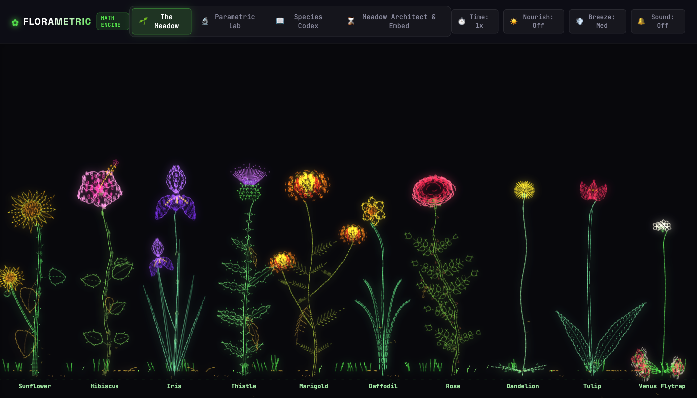
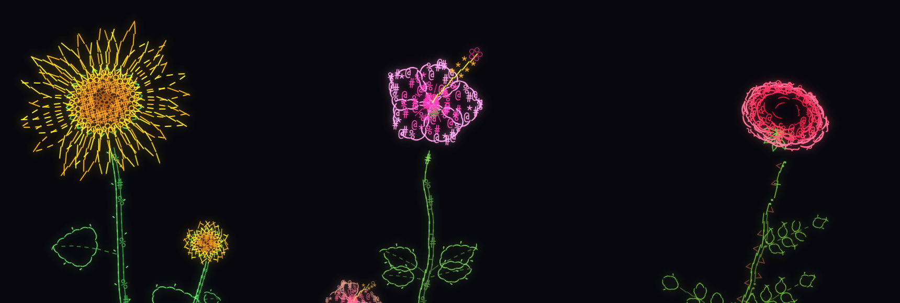
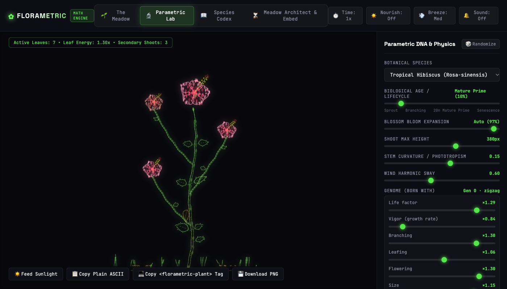
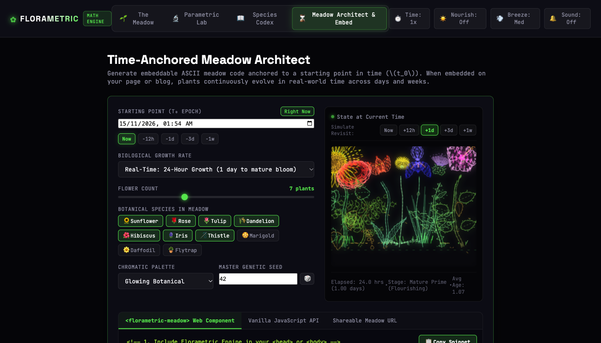
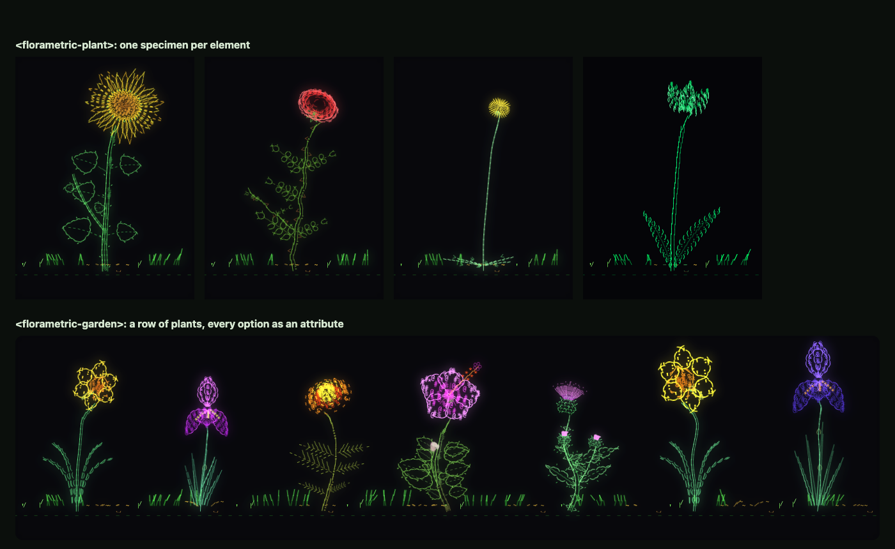
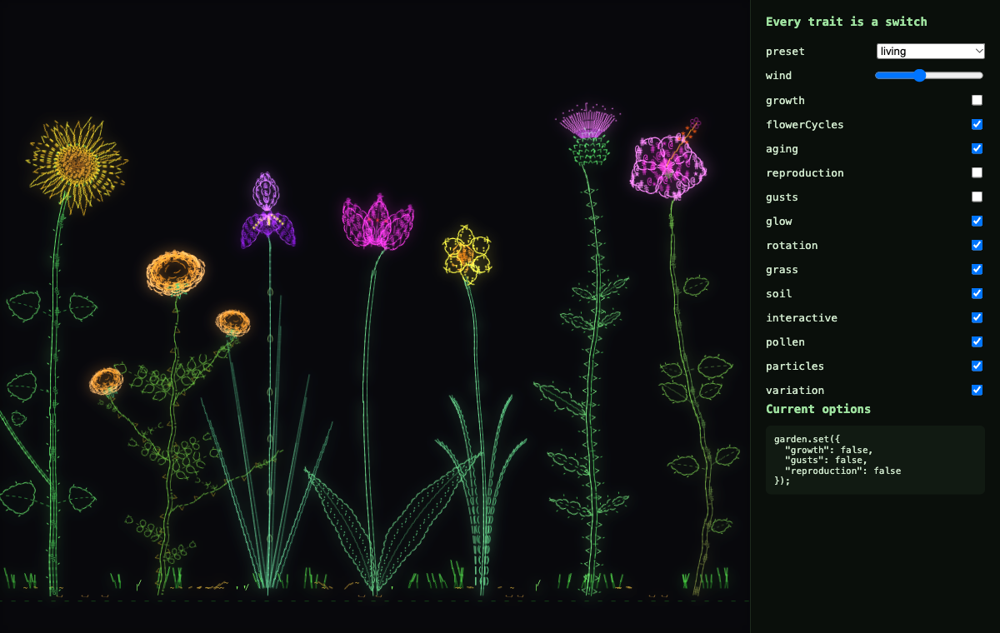
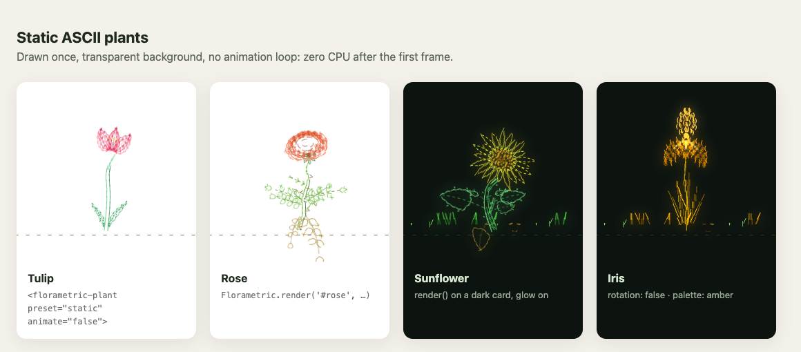

# ✿ Florametric

[](https://opensource.org/licenses/MIT)
[-success.svg)](florametric.js)
[-blue.svg)](#-performance)
[](https://shamsghani.github.io/florametric/)

**Florametric** is an open-source, zero-dependency generative mathematical engine for glowing, living ASCII flowers and plants. Every stem, leaf, sepal, petal floret, and drifting seed is simulated in real time using continuous mathematical formulations—growth logistic curves, harmonic Euler wind oscillations, polar coordinate phyllotaxis, and biological rules.

Designed for the modern web, terminal CLIs, blogs, and interactive creative coding environments.

🌿 **Live Interactive Meadow & Parametric Studio**: [https://shamsghani.github.io/florametric/](https://shamsghani.github.io/florametric/)

```html
<script src="https://shamsghani.github.io/florametric/florametric.js"></script>
<florametric-garden species="rose,tulip,iris" count="5"></florametric-garden>
```

That's the whole integration. Every trait (growth, wind, glow, wilting, reseeding, …) is a switch: see the **[Integration Guide](#-integration-guide)**.

---


---

## ✨ Highlights & Features

### 🧬 Born With a Genome
Every plant is born with a heritable **genome** that it keeps for life. Each trait is a factor around `1.0` (colour genes are normalised to `[-1, 1]`):

| Gene | Range | What it controls |
| :--- | :--- | :--- |
| `lifeFactor` | 0.70 – 1.40 | Longevity: how long the mature prime lasts, leaf & flower lifespans |
| `vigor` | 0.80 – 1.25 | Metabolic growth rate (and a deeper green stem) |
| `branching` | 0.25 – 1.50 | Number, angle and length of axillary branches |
| `leafing` | 0.60 – 1.50 | Leaf cluster count and leaf size |
| `flowering` | 0.65 – 1.40 | Flower size, bloom duration, branch-flower fertility, seed count |
| `size` | 0.85 – 1.22 | Overall shoot height and flower scale |
| `hue` / `saturation` / `lightness` | −1 – 1 | Petal colour (tulips & roses vary widely, sunflowers barely) |
| `growthNoise` | 0.08 – 0.28 | How much growth speed wanders over time |
| `shapeNoise` | 0.35 – 1.10 | Stem meander, leaf tilt, petal irregularity |
| `windSensitivity` | 0.75 – 1.30 | Stem flexibility in the breeze |

Seeds carry a **mutated copy of their parent's genome**, so lineages drift gradually over generations instead of jumping to unrelated plants.


*Eight roses, eight genomes: petal hue, size and branching differ while every plant stays recognisably a rose.*

### 🌊 Noise-Driven Growth (No Two Plants Alike)
Seeded **simplex noise** (smooth, coherent randomness rather than `Math.random()` jitter) is applied while the plant actually grows:
* **Growth velocity** wanders smoothly over time but never reverses, so growth stays monotonic.
* **Stem meander** is keyed to *absolute height*, so tissue that has already grown keeps its shape while the apex extends.
* **Leaves** get individual emergence speeds and tilts; **petals** get per-individual length irregularity.
* **Wind** comes from a travelling gust field: neighbouring plants bend together and gust fronts roll across the meadow.

### 🌿 Species Botany: Real Shoots, Real Flowers
Every species follows a botanical profile from a [study of the real plants](docs/BOTANY.md).


* **Shoots:**
  * Rose canes zigzag at every node and carry hooked prickles.
  * Dandelion scapes are smooth, hollow and whippy in the wind.
  * Sunflower stalks are stout, hairy and nod at maturity.
  * Thistle stems carry spiny wings and hibiscus stems turn woody.
  * Daffodil scapes are two-edged with a swan neck, so the flower faces sideways.
  * Scapes such as tulip and daffodil never branch.
* **Leaves:**
  * Heart-shaped (sunflower) and oval (hibiscus) blades.
  * Compound leaves with leaflets (rose), and finely divided ones (marigold).
  * Spiny-lobed thistle leaves.
  * Sword fans (iris), straps (daffodil), broad wavy leaves (tulip).
  * Lion's-tooth rosettes (dandelion) and flytrap trap rosettes.
* **Flowers:**
  * Sunflower: Fibonacci ray florets around a spiral seed disc.
  * Rose: a spiral of cupped petals.
  * Hibiscus: a staminal column with anthers.
  * Bearded iris: standards above falls.
  * Daffodil: a trumpet corona.
  * Tulip: a goblet.
  * Marigold: bicolour pompons.
  * Thistle: a spiny urn with a purple brush.
  * Dandelion: a yellow head that becomes a seed clock.
  * Flytrap: a white umbel.

  Buds are the same petals folded closed and still green, so opening is one continuous movement.

### 🔄 ASCII Glyph Language with Rotation
Strokes pick the ASCII character closest to their direction (`|`, `/`, `-`, `\`) and are only nudged by the small leftover angle, so curves stay smooth without losing the ASCII look. Petals and leaves are outlined in `( )` brackets and filled with per-species textures (`@ # *` hibiscus, `% & @` marigold, `{ ( %` rose, `! %` tulip). Stems weave in `%`, `#` and `:`, and flower heads nod with the stem tip.


*Close-up: `/ | - \` ray florets and a spiral seed disc, `@ # *` hibiscus petals around a staminal column, a `{ (` rose spiral on a cane with `<>` prickles, and `( )` leaf outlines.*

### 🌱 Self-Seeding Meadow
Plants are individuals, not loops. A flower that finishes **sets seed**, and the seeds fall and drift on the wind. Where they land, they may take root as **new plants in new spots**. A plant that reaches the end of its life **dies and is removed**. Competition keeps the meadow healthy:
* a minimum spacing between seedlings;
* a cap on any one species' share of the meadow;
* occasional wind-borne seeds of other species.

### 🌸 100% Parametric & Mathematical Botany
* **Zero Pre-Baked Art**: No static character templates or hardcoded ASCII art blocks. All anatomy is computed continuously from mathematical functions.
* **Continuous Growth Kinetics**: Smooth logistic shoot elongation parameterized by biological age:
  $$L(t) = L_{\max} \cdot \frac{1 - e^{-4t}}{1 - e^{-4}}$$
* **Harmonic Kinematics & Wind Dynamics**: Multi-frequency sinusoidal Euler oscillations create organic, responsive breeze swaying:
  $$W(y, t) = \sin(\omega t + k y) \cdot A_{\text{wind}} \cdot \left(\frac{y}{H}\right)^{1.4}$$
* **Pointer Heliotropism**: Living stems and flower heads dynamically sense and bend towards cursor and touch interactions.

---

### 🌾 Interactive Dandelion Seeds & 5% Soil Germination
Clicking or tapping a mature dandelion clock scatters 32 individual parachute seeds into the air. Seeds catch the breeze and drift with natural pendulum swinging kinematics:
$$\Delta x = v_x + \sin(\omega_{\text{swing}} t + \phi) \cdot 1.4, \qquad v_y \xrightarrow{\text{lerp}} 0.75$$

When seeds land on the soil line, each seed has an authentic **$1/20$ ($5\%$) probability** of taking root and sprouting into a new dandelion seedling, organically repopulating your meadow.


---

### ☀️ Sunlight & Plant Food Nourishment Mode
Toggle **Nourish Mode ☀️** to shower golden nutrient motes onto the garden by clicking, tapping, or dragging. Sunlight motes accelerate plant metabolic growth velocity ($\frac{d(\text{age})}{dt}$), prompt tightly closed buds to burst into bloom, and revitalize botanical vitality.


---

### ⏱️ Internal Biological Clock & Natural Time Passing
Flowers grow continuously over time without requiring manual input. The biological engine supports variable speed time dilation:
* `1x ⏱️ Normal`: Natural growth (about 40 s from seed to full bloom).
* `3x ⏩ Fast`: Accelerated progression (about 13 s).
* `8x 🚀 Rapid`: Rapid blooming (about 5 s).
* `⏸️ Paused`: Freeze time to inspect intricate petal geometry and physics.

---

### 🌷 From Sprout to Seed Head
Every stage is continuous, with no state switches or pop-in:
* **Growth:** the stem elongates and leaves unfurl; they lengthen first and broaden later.
* **Bud:** the petals are the same petals folded closed and still green. As the bud opens, the petals take on their colour.
* **Bloom:** the flower reaches its full species form.
* **Wilting:** outer petals fall one by one, colours fade in steps and the head droops. Only that head wilts; the rest of the plant stays green.
* **Seed head:** a sunflower seed disc, rose hip or seed capsule drops its seeds in waves. Then the next bud forms.
* **Old age:** the plant browns from the base up.


---

### 🌿 Continuous Biological Life Cycle & Perpetual Reseeding
Plants are not static illustrations — they live, mature, reproduce, senesce, and reseed in an eternal biological cycle:
* **Sprout ($\tau \in [0.0, 0.25)$)**: Tender young seedling pushes through the soil.
* **Vegetative Growth ($\tau \in [0.25, 0.55)$)**: Stems elongate, leaves unfurl from tiny nascent buds (`maturity \in [0.08, 1.0]`), and secondary shoots branch out **bilaterally from both left and right axils**.
* **Anthesis & Peak Bloom ($\tau \in [0.55, 1.05)$)**: Bounded Fibonacci seed discs form surrounded by radiant ray petals; full photosynthetic leaf vigor.
* **Senescence & Wilting ($\tau \in [1.05, 1.35)$)**: The whole plant ages. The stem bows as it loses turgor, petals droop and shed on the wind, and the plant browns gradually **from the base upward** (green → straw → brown), so the tip stays green longest.
* **Flower Wilting Is Local**: When one flower finishes its bloom, only that head wilts and only the top of its own stalk yellows. The rest of the plant, and any other flowers still blooming, stay healthy.
* **Gradual Wilt → Seed Head**: A finishing flower keeps its open shape while its outer petals fall one by one, its colours fade in steps toward the active theme's own withered tones, and it droops. It then becomes a **seed head** (a sunflower seed disc, a rose hip, or a seed capsule) that drops its seeds in three waves before the next bud forms.
* **Genome-Driven Ageing**: Long-lived, vigorous genomes brown later and more slowly. Sunlight re-opens a spent flower gradually from a half-open bud.
* **Death & Dispersal ($\tau \ge 1.40$)**: The plant decays into soil mulch and is removed. Its last seeds scatter; offspring sprout elsewhere with an inherited, slightly mutated genome. (Single-specimen embeds use `lifecycle: 'respawn'` and regrow in place instead.)
* **Sunlight Revitalization**: Showering sunlight (`feed()`) on aging or wilting plants reverses senescence and revitalizes cellular vigor!

---

### 🌱 Living Meadow Grass (Sprout -> Grow -> Wilt -> Die)
Tufts of meadow grass line the soil bed, each cycling through its own 4-stage biological life cycle:
1. **Sprout**: Tender pale-green shoots emerging from soil (`.`, `'`, `|`, `/`).
2. **Grow**: Lush chlorophyll blades swaying under breeze and cursor deflection (`|`, `/`, `\`).
3. **Wilt**: Drooping golden-amber straw bending towards the earth (`/`, `\`, `~`).
4. **Die**: Organic mulch stubble (`.`, `_`, `,`) returning nutrients to soil before reseeding.

---

### 🎲 Deterministic Seeds & Placement Variance
On top of the genome, a deterministic PRNG seed places each individual's leaves, branches and timings:
* **Stem Habit**: *Erect columnar, graceful weeping curve, S-curve, windswept lean, or angular zigzag*.
* **Bilateral Axillary Branching**: Shoots emerge bilaterally from alternating left and right leaf axils with distinct angles and lengths.
* **Continuous Leaf Unfurling**: Leaves emerge as nascent buds and expand smoothly as the shoot elongates (zero pop-in).
* **Bounded Fibonacci Disc Florets**: Central sunflower seed heads are strictly confined inside radial Fermat spirals ($r \le R_{\text{disc}}$) cradled by outward-flaring ray petals.
* **Phyllotaxis & Internodes**: Dynamic spacing and leaf clustering with size variance across photosynthetic and juvenile foliage.
* **Head Tilt**: Phototropic angle variation ($-20^\circ$ to $+20^\circ$).

---

### 🔬 The Parametric Lab & Species Codex
Edit a specimen's **genome** with sliders (life factor, vigor, branching, leafing, flowering, size, petal hue, noise), test wind resistance, watch live leaf and branch metrics, and export the result as plain ASCII, a `<florametric-plant>` tag or a PNG. The **Biological Age** slider regrows the specimen to any age by replaying its life (`plant.growTo(age)`), so leaves, branches and flowers always match the age you pick.

| Parametric Lab | Species Codex Gallery |
| :---: | :---: |
|  |  |

---

### ⏳ Time-Anchored Persistent Meadows
A meadow can be anchored to a start time (t₀) and grow in **real-world time**. Visitors who come back a day or a week later find the same plants, further along in their lives. The **Meadow Architect** tab previews the meadow at any moment (`Now`, `+12h`, `+1d`, `+3d`, `+1w`) and generates the embed code:

```html
<florametric-meadow start-time="1794689013331" speed="24h" plant-count="7"
  species="sunflower,rose,tulip,dandelion,iris,thistle,hibiscus" seed="42"></florametric-meadow>
```

Speeds: `1h`, `24h` (bloom in a day), `3d`, `7d`, `30d` or a multiplier such as `0.1x`. In JavaScript: `Florametric.createPersistentMeadow(canvas, { startTime, speed, species, seed })`.



---

## 🚀 Integration Guide

Florametric is **one file with no dependencies**. Every trait (growth, wind, glow, rotation, wilting, reseeding and the rest) can be switched on or off with an HTML attribute, a JavaScript option, or at runtime. You can show living plants, calm ones, or a still picture that draws once and uses no CPU after that.

> **Prefer clicking?** The [Embed tab of the live site](https://shamsghani.github.io/florametric/#embed) builds the snippet for you: pick a plant, a garden or a meadow, switch features on and off, and copy the code. The same step-by-step guide is under the builder.


### Step 1: Add the script

Load it once per page, anywhere before you use it:

```html
<!-- From GitHub Pages -->
<script src="https://shamsghani.github.io/florametric/florametric.js"></script>

<!-- or from the jsDelivr CDN (pin a commit or tag in production) -->
<script src="https://cdn.jsdelivr.net/gh/shamsghani/florametric@main/florametric.js"></script>
```

With a bundler (Vite, webpack, Next.js, …), install it from GitHub. TypeScript types (`florametric.d.ts`) are included:

```bash
npm install github:shamsghani/florametric
```

```javascript
import Florametric from 'florametric';           // ES modules / TypeScript
// const Florametric = require('florametric');  // CommonJS / Node
```

Or just download [`florametric.js`](florametric.js) and serve it with your site.

### Step 2: Place an element

Three custom elements cover most uses. They start themselves, size to their box, and pause while scrolled off-screen. No JavaScript needed.

```html
<!-- One plant, centred -->
<florametric-plant type="rose"></florametric-plant>

<!-- A row of plants that grows, blooms and reseeds while the page is open -->
<florametric-garden species="sunflower,iris,tulip" count="6"></florametric-garden>

<!-- A meadow that grows in real time from a start date; visitors see it age over days -->
<florametric-meadow start-time="2026-11-15" speed="7d" species="sunflower,rose,tulip"></florametric-meadow>
```



| Element | What it shows | Its own attributes |
| :--- | :--- | :--- |
| `<florametric-plant>` | One specimen, centred | `type`, `age`, `bloom`, `height`, `seed`, `curvature`, `genome` |
| `<florametric-garden>` | A row of plants | `species` (comma list), `count`, `plants`, `age`, `bloom`, `height` |
| `<florametric-meadow>` | A [time-anchored meadow](#-time-anchored-persistent-meadows) | `start-time`, `speed`, `plant-count`, `species`, `seed`, `config` |

All three also accept **every option** in the [options reference](#options-reference) as a kebab-case attribute.

### Step 3: Size and style it

Elements size like a `<div>`. Defaults: a plant is 280 px wide, a garden fills the width at 360 px tall. Set any size with CSS; plants scale themselves to fit the box, so flowers are never cut off at the top.

```html
<florametric-garden style="height: 240px" species="tulip,daffodil"></florametric-garden>

<!-- Sit on your own page colour: transparent background, no grass or soil line -->
<florametric-plant type="iris" background="transparent" grass="false" soil="false"></florametric-plant>

<!-- Or move the soil line: pixels from the bottom edge -->
<florametric-garden ground-offset="20"></florametric-garden>
```

The canvas has `role="img"` and an `aria-label`, so screen readers announce it once instead of reading thousands of characters. Motion follows the visitor's `prefers-reduced-motion` setting unless you set `reduced-motion`.

### Step 4: Switch traits on or off

Start from a **preset**, then override single traits. Attributes are kebab-case (`flower-cycles`); JavaScript options are camelCase (`flowerCycles`).

| Preset | What it does |
| :--- | :--- |
| `living` | The default: everything on |
| `static` | A still life: no growth, wind, wilting, particles, pointer or reseeding |
| `calm` | Gentle breeze, no gusts, particles, pollen or reseeding; half-speed clock |
| `classic` | Upright, unrotated ASCII without glow |
| `minimal` | No grass or soil line, transparent background, no particles or pollen |

```html
<!-- Static plants: nothing moves -->
<florametric-garden preset="static" species="rose,tulip" count="4"></florametric-garden>

<!-- A still image: draws one frame, then no animation loop at all (zero CPU) -->
<florametric-plant type="tulip" preset="static" animate="false"></florametric-plant>

<!-- Living, but flowers never wilt and nothing reseeds -->
<florametric-garden flower-cycles="false" reproduction="false"></florametric-garden>

<!-- Grows to its prime and stays there, in still air -->
<florametric-garden aging="false" wind="0"></florametric-garden>

<!-- Every plant is its species' textbook form (no genetic variation) -->
<florametric-garden variation="false" species="sunflower,iris"></florametric-garden>
```

Changing an attribute later updates the element immediately (`el.setAttribute('wind', '0')`).



Static plants on light cards, drawn once (`examples/static-cards.html`):



### Step 5: Control it from JavaScript (optional)

Three helpers take a CSS selector, a `<canvas>` or any container element (a canvas is created inside it):

```javascript
// A garden: species names, or specs with a position (pixels, a 0..1 fraction or 'NN%')
const garden = Florametric.garden('#hero', {
  plants: ['sunflower', { type: 'rose', x: 0.7, age: 2 }, { type: 'tulip', x: '90%' }],
  preset: 'calm',
  wind: 0.3
});

// One plant
Florametric.plant('#card', { type: 'iris', palette: 'amber' });

// A still image: static preset, one frame, no animation loop
Florametric.render('#thumb', { type: 'tulip', background: 'transparent' });
```

Change any option while it runs, listen to life events, and clean up:

```javascript
garden.set({ wind: 0, glow: false });          // any option, any time
garden.set({ preset: 'static' });              // or a whole preset
garden.addPlant({ type: 'daffodil', x: 0.5 }); // plant more
garden.stop(); garden.start();

garden.on('germinate', (plant, x) => console.log(plant.type, 'sprouted at', x));
garden.on('death',     (plant, x) => console.log(plant.type, 'finished its life'));
garden.on('reseed',    (plant, x) => {});      // a plant regrew in place
garden.on('blow',      (plant, x, y) => {});   // a dandelion clock was blown

garden.destroy();                              // stop and remove every listener
```

An element's garden is available as `el.garden`, and `el.set({...})` is a shortcut for `el.garden.set({...})`.

**Choosing a genome.** Plants get a random genome from their seed. Pass `genome` to set traits; anything you leave out is randomised from the seed. Garden-wide defaults go in the `genome` option.

```javascript
// A long-lived, bushy, pink-shifted rose
garden.addPlant({ type: 'rose', x: 0.3, seed: 2026, genome: { lifeFactor: 1.35, branching: 1.4, hue: -0.6 } });

// Every new plant in this garden leans blue and large
garden.set({ genome: { hue: 0.4, size: 1.15 } });

// Inspect, breed and serialise genomes
const g = Florametric.Genome.random('tulip', 7);
const child = g.mutate(8);          // offspring: gradual drift, generation + 1
console.log(child.toJSON());
```

**Low-level API.** `new Florametric.AsciiGarden(canvas, options)` gives you an empty garden with the same options: add plants with `addPlant`, then call `start()`. Advanced population settings: `seedGermination` (chance a fallen seed takes root, `0.12`), `maxPlants` / `minPlants` (default from the width) and `maxSpeciesShare` (`0.3`).

### Step 6: Frameworks

Custom elements work in any framework. Load the script once (or `import 'florametric'`), then use the tags.

**React**

```jsx
import { useEffect, useRef } from 'react';
import Florametric from 'florametric';

export function Garden({ wind = 0.6 }) {
  const ref = useRef(null);
  const garden = useRef(null);
  useEffect(() => {
    garden.current = Florametric.garden(ref.current, { species: ['rose', 'tulip'], count: 5 });
    return () => garden.current.destroy();
  }, []);
  useEffect(() => { garden.current?.set({ wind }); }, [wind]);
  return <div ref={ref} style={{ height: 320 }} />;
}
```

**Vue**

```vue
<template><florametric-plant type="iris" :wind="wind" /></template>
<script setup>
import 'florametric';
defineProps({ wind: { type: Number, default: 0.6 } });
</script>
```

In Vue, tell the compiler the tags are custom elements: `compilerOptions.isCustomElement = tag => tag.startsWith('florametric-')`. **Svelte** and **Astro** need nothing extra. With **server-side rendering** (Next.js, Nuxt, SvelteKit), create gardens inside `useEffect` / `onMounted` / `onMount`: the library needs a browser to draw, but importing it on the server is safe.

### Step 7: Plain text (Node, terminals, READMEs)

`generateString` returns plain text ASCII art. The whole plant is fitted into `cols × rows` with terminal-cell aspect correction, and rotated strokes are mapped to the nearest of `| / - \`:

```javascript
const Florametric = require('florametric');
console.log(Florametric.generateString({ type: 'sunflower', age: 1, bloom: 1, cols: 45, rows: 35 }));
```

Try it: `node examples/node-text.js tulip`.

### Options reference

Every option works as a JavaScript option, as an element attribute, and in `garden.set()`. `Florametric.defaults` and `Florametric.presets` hold the values at runtime.

| Option | Attribute | Default | What it does |
| :--- | :--- | :--- | :--- |
| **Look** | | | |
| `palette` | `palette` | `'botanical'` | `botanical`, `phosphor`, `amber`, `cyberpunk` or `monochrome` |
| `background` | `background` | `'#050508'` | Any CSS colour, or `transparent` |
| `glow` | `glow` | `true` | Soft bloom glow around the glyphs |
| `glowStrength` | `glow-strength` | `1` | Glow intensity |
| `rotation` | `rotation` | `true` | Glyphs follow curves; `false` = classic upright ASCII |
| `grass` | `grass` | `true` | Living grass along the soil |
| `soil` | `soil` | `true` | The dashed soil line |
| `groundOffset` | `ground-offset` | `50` | Pixels from the bottom edge to the soil line |
| **Motion** | | | |
| `wind` | `wind` | `0.6` | Breeze strength; `0` = still air |
| `gusts` | `gusts` | `true` | Gust fronts rolling across the plants |
| `reducedMotion` | `reduced-motion` | `null` | Gentle motion; `null` = follow the visitor's system setting |
| `fps` | `fps` | `0` | Frame-rate cap; `0` = display refresh rate |
| `pauseOffscreen` | `pause-offscreen` | `true` | Stop drawing while scrolled out of view |
| **Life** | | | |
| `growth` | `growth` | `true` | Plants grow and age over time |
| `timeSpeed` | `time-speed` | `1` | Speed of the biological clock |
| `aging` | `aging` | `true` | `false` = plants reach their prime and stay there |
| `flowerCycles` | `flower-cycles` | `true` | `false` = flowers stay in bloom (no wilting or seed heads) |
| `reproduction` | `reproduction` | `true` | Spent flowers seed new plants; `false` = regrow in place |
| `immigration` | `immigration` | `true` | Occasional wind-blown seeds of new species |
| `variation` | `variation` | `true` | `false` = every plant is its species' textbook individual |
| `genome` | `genome` (JSON) | `null` | Default genes for new plants, e.g. `{"hue": 0.4}` |
| `seed` | `seed` | `42` | Master seed: same seed, same plants |
| **Interaction** | | | |
| `interactive` | `interactive` | `true` | Pointer bending, pollen and dandelion blowing |
| `pointerMode` | `pointer-mode` | `'reach'` | `reach` (bend toward), `flinch` (away) or `none` |
| `pollen` | `pollen` | `true` | Pollen trail behind the pointer |
| `particles` | `particles` | `true` | Falling petals and leaves |
| `dandelionBlow` | `dandelion-blow` | `true` | Click a seed clock to blow its seeds |
| **Content** | | | |
| `preset` | `preset` | none | `living`, `static`, `calm`, `classic` or `minimal`, applied first |
| `type` | `type` | `'sunflower'` | Species of a single plant |
| `species` / `count` | `species` / `count` | all ten / up to `7` | Species to cycle through and how many plants (one each, at most 7, by default) |
| `plants` | `plants` | none | Exact list: names, or `{ type, x, age, seed, genome, … }` specs |
| `age` | `age` | `1` | Biological age: `0`–`1` grows, `1`–`21` prime, `21`–`23.5` old age |
| `bloom` | `bloom` | auto | `0`–`1` override of the flower's opening |
| `height` | `height` | fits the box | Shoot height in pixels (capped so the flower fits) |
| `animate` | `animate` | `true` | `false` = draw a single still frame |
| `autoStart` | — | `true` | `false` = create without starting the loop |

Older names still work: `bloom: false` (now `glow`) and `lifecycle: 'respawn'` (now `reproduction: false`).

### Examples and troubleshooting

The [`examples/`](examples/) folder has runnable pages. Serve the repository (`npm start`, then open `http://localhost:8080/examples/`):

| File | Shows |
| :--- | :--- |
| [`web-components.html`](examples/web-components.html) | The three elements and their attributes |
| [`feature-toggles.html`](examples/feature-toggles.html) | Every trait as a live switch, with the matching `garden.set()` call |
| [`static-cards.html`](examples/static-cards.html) | Still plants on light cards, drawn once |
| [`node-text.js`](examples/node-text.js) | Plain-text plants in the terminal |

* **Nothing appears.** The element needs a height: give it one, or its parent one. Check the console for a 404 on the script.
* **Flowers look cut off.** Set `height` lower or make the box taller; with no `height`, plants fit the box automatically.
* **Too busy for my page.** Try `preset="calm"`, or `particles="false" pollen="false" gusts="false"`.
* **It uses CPU while hidden.** It doesn't: drawing pauses off-screen (`pause-offscreen`). For no loop at all, use `animate="false"` or `Florametric.render()`.
* **Same plants on every visit.** That's the master `seed`; change it, or pass `seed` per plant, for different individuals.

---

## 🌿 Botanical Species Codex

Florametric features 10 biologically distinct plant species, each with unique stem habit architectures and foliage guidelines:

| Species | Botanical Name | Shoot | Foliage | Flower |
| :--- | :--- | :--- | :--- | :--- |
| **Sunflower** | *Helianthus annuus* | Stout, hairy, ruler-straight stalk; head nods at maturity | Large heart-shaped serrated leaves on long petioles | 21 or 34 Fibonacci ray florets around a spiral seed disc |
| **Hibiscus** | *Hibiscus rosa-sinensis* | Woody shrub, slight bends at nodes, bark at the base | Glossy oval serrated leaves | Five overlapping petals, dark eye, long staminal column |
| **Iris** | *Iris germanica* | Ruler-straight scape with papery spathes | Basal fan of sword-shaped blades | Three upright standards over three bearded falls |
| **Thistle** | *Cirsium vulgare* | Ridged stem with spiny wings | Deeply lobed, spine-tipped leaves | Spiny urn of bracts crowned by a purple brush |
| **Marigold** | *Tagetes patula* | Bushy, reddish, ridged, short internodes | Finely divided pinnate leaves | Bicolour ruffled pompon |
| **Daffodil** | *Narcissus pseudonarcissus* | Two-edged leafless scape with a swan neck | Flat strap leaves arching from the bulb | Six pale tepals around a ruffled orange cup, turned three-quarters toward the viewer |
| **Rose** | *Rosa rubiginosa* | Zigzag cane with hooked prickles; arching branches | Odd-pinnate leaflets | Golden-angle spiral of cupped petals; forms a hip |
| **Dandelion** | *Taraxacum officinale* | Hollow, smooth, whippy scape | Basal rosette of lion's-tooth leaves | Yellow ray head that reopens as a seed clock |
| **Tulip** | *Tulipa gesneriana* | Stout, smooth, glaucous scape | Two or three broad, wavy leaves | Goblet of six tepals with dark stamens |
| **Venus Flytrap** | *Dionaea muscipula* | Thin scape far above the traps | Rosette of hinged traps with marginal cilia | Small umbel of white flowers |

---

## 🔬 Five Biological Growth Rules

1. **Internode Spacing**: As shoots elongate, internode distances expand dynamically based on species density rules.
2. **Spacing & Bunching Inhibition**: Adjacent leaf nodes exert an inhibition field ($\ge 25\text{px}$) to prevent artificial clipping, while allowing natural paired clustering.
3. **Auxin-Regulated Branching**: Lateral axillary branches only emerge once a shoot develops sufficient leaf photosynthetic vigor ($\ge 3\text{ active leaves}$).
4. **Photosynthetic Energy Scaling**: Active leaf surface area dynamically modulates apical flower diameter and floret count ($0.8\times \to 1.45\times$).
5. **Basal Senescence & Wilting**: Mature plants redirect carbohydrates toward blossoms; oldest basal leaves wither, droop downward, and transition to golden-brown autumn hues.

---

## 🏛️ Architecture

`florametric.js` is a single zero-dependency file organised into layers. Each layer depends only on the layers above it:

| # | Layer | Responsibility |
| :--- | :--- | :--- |
| 1 | `PRNG`, `SimplexNoise`, colour utils | Deterministic randomness, coherent noise, HSL tinting |
| 2 | `PALETTES` | Base colours per theme (`colorVariance` keeps themed palettes on-theme) |
| 3 | `Genome` | Heritable traits, mutation, per-individual palette tinting |
| 4 | `BotanicalSimulator` | Growth, member lifecycles (leaves, branches, flowers), noise |
| 5 | `BotanicalArchitect`, `ProceduralFlowerRenderer` | Geometry → glyph lists `{ x, y, char, fg, size, rot }` |
| 6 | `GlyphRenderer` / `GlyphAtlas`, `TextRasterizer` | Glyphs → canvas (sprite atlas, rotation) or plain text |
| 7 | `WindField`, `GrassTuft`, `AsciiPlant`, `AsciiGarden` | The living, self-seeding scene |
| 8 | `GARDEN_DEFAULTS`, `PRESETS`, `garden` / `plant` / `render` | Options for every trait, presets, one-call helpers, attribute parsing |
| 9 | `<florametric-plant>`, `<florametric-garden>`, `<florametric-meadow>` | Web Components with live attributes (pause when scrolled off-screen) |

---

## ⚡ Performance

Rotating text with `fillText` is a slow path in the browser: rotated glyphs bypass its glyph cache. Florametric instead rasterises each `(character, colour, size)` once into a **glyph sprite atlas** and blits sprites with `drawImage`, so rotated glyphs cost about the same as upright ones. Sprite sizes are bucketed and scaled on the GPU, so the atlas stays small.

Measured in Chrome 157 on an Apple M1 Pro:

| Scene | Glyphs | ms / frame |
| :--- | :--- | :--- |
| `fillText` with rotation (naïve renderer) | 5,215 | ~61 |
| Glyph atlas with rotation (Florametric) | 5,215 | ~10 |
| Default meadow, full frame (simulation, glyphs, bloom) | ~5,000 | **9.8** |

A full frame fits inside the 16.6 ms budget for 60 FPS. The glyph count grows with the number of mature plants, so a very wide meadow of large, branched plants costs more.

Other techniques:
* **Screen-space bloom:** one blur of a 1/3-scale copy per frame, instead of `shadowBlur` on every glyph.
* **Only visible views animate:** hidden tabs stop their loops, and every garden pauses while off-screen (IntersectionObserver, `pauseOffscreen`).
* **Optional frame cap and still frames:** `fps: 30` halves the work; `animate: false` / `Florametric.render()` draws once and stops.
* **Clamped `dt`:** a backgrounded tab doesn't fast-forward the simulation when you return.

---

## 🧪 Testing & Verification Suite

Florametric maintains invariant test suites covering biological rules, seed genetics, the integration API and browser execution. Run every JavaScript suite with:

```bash
npm test

# Integration API: options, presets, toggles, set(), events, helpers, attributes
node test/test_integration_api.js

# Run mathematical invariant suite (monotonic elongation, internodes, auxin branching, senescence)
python test/test_botanical_math_invariants.py

# Run dandelion physics, seed flight, and 1/20 germination probability suite
node test/test_dandelion_mechanic.js

# Run genome, growth-noise, glyph-rotation, text-export & self-seeding suite
node test/test_genome_noise_rotation.js

# Run species botany suite (shoot straightness, textures, flexibility, flower identity)
node test/test_botany_profiles.js

# Run rendering performance benchmark (60 frames across 8 mature specimens)
node test/benchmark_render.js

# Run live browser headless Chrome CDP integration test
python test/cdp_browser_check.py
```

---

## 📄 License

MIT License © 2026 [Shams Ghani](https://github.com/shamsghani).

Free for personal, academic, and commercial open-source projects.
