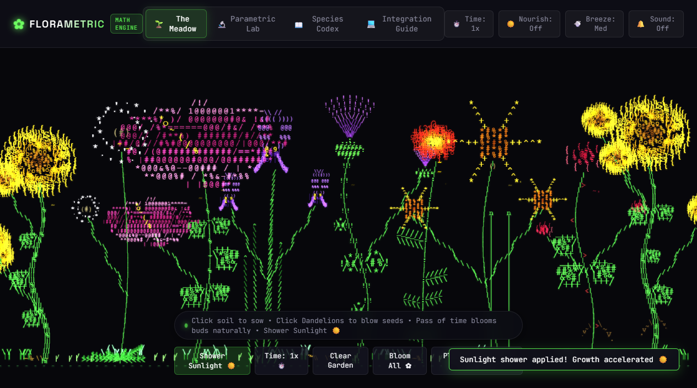
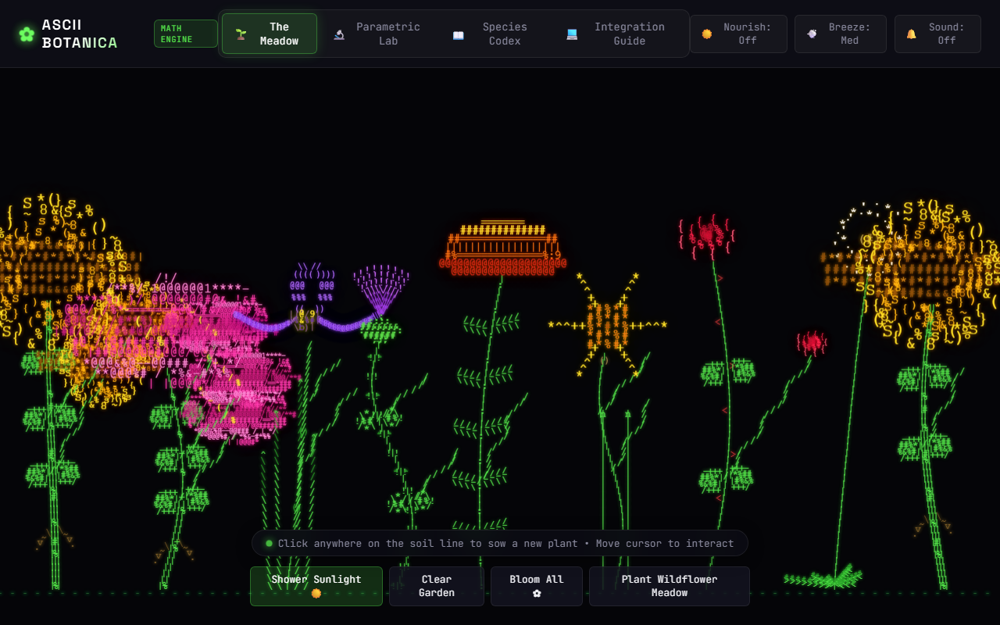
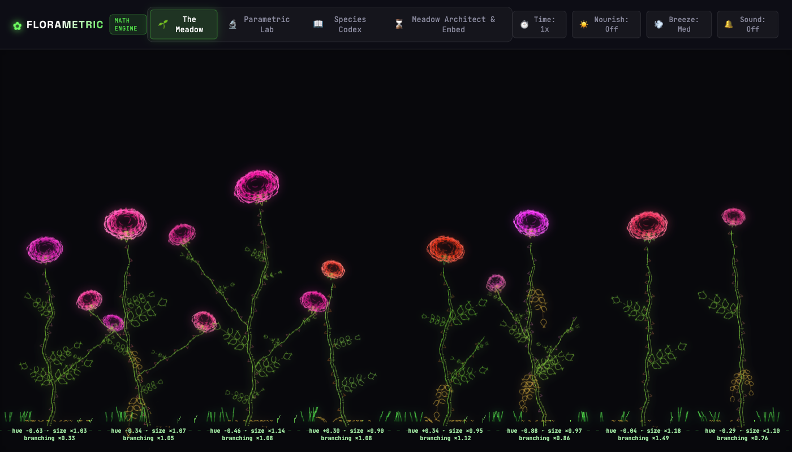

# ✿ Florametric

[](https://opensource.org/licenses/MIT)
[-success.svg)](florametric.js)
[-blue.svg)](#-performance)
[](https://shamsghani.github.io/florametric/)

**Florametric** is an open-source, zero-dependency generative mathematical engine for glowing, living ASCII flowers and plants. Every stem, leaf, sepal, petal floret, and drifting seed is simulated in real time using continuous mathematical formulations—growth logistic curves, harmonic Euler wind oscillations, polar coordinate phyllotaxis, and biological rules.

Designed for the modern web, terminal CLIs, blogs, and interactive creative coding environments.

🌿 **Live Interactive Meadow & Parametric Studio**: [https://shamsghani.github.io/florametric/](https://shamsghani.github.io/florametric/)

---



---

## ✨ Highlights & Features

### 🧬 Born With a Genome
Every plant is born with a heritable **genome** that it keeps for life. Each trait is a factor around `1.0` (colour genes are normalised to `[-1, 1]`):

| Gene | Range | What it controls |
| :--- | :--- | :--- |
| `lifeFactor` | 0.70 – 1.40 | Longevity: how long the mature prime lasts, leaf & flower lifespans |
| `vigor` | 0.80 – 1.25 | Metabolic growth rate (and a deeper green stem) |
| `branching` | 0.25 – 1.50 | Number, angle and length of axillary branches |
| `leafing` | 0.60 – 1.50 | Leaf cluster count and leaf size |
| `flowering` | 0.65 – 1.40 | Flower size, bloom duration, branch-flower fertility, seed count |
| `size` | 0.85 – 1.22 | Overall shoot height and flower scale |
| `hue` / `saturation` / `lightness` | −1 – 1 | Petal colour (tulips & roses vary widely, sunflowers barely) |
| `growthNoise` | 0.08 – 0.28 | How much growth speed wanders over time |
| `shapeNoise` | 0.35 – 1.10 | Stem meander, leaf tilt, petal irregularity |
| `windSensitivity` | 0.75 – 1.30 | Stem flexibility in the breeze |

Seeds carry a **mutated copy of their parent's genome**, so lineages drift gradually over generations instead of jumping to unrelated plants.

### 🌊 Noise-Driven Growth (No Two Plants Alike)
Seeded **simplex noise** (smooth, coherent randomness rather than `Math.random()` jitter) is applied while the plant actually grows:
* **Growth velocity** wanders smoothly over time but never reverses, so growth stays monotonic.
* **Stem meander** is keyed to *absolute height*, so tissue that has already grown keeps its shape while the apex extends.
* **Leaves** get individual emergence speeds and tilts; **petals** get per-individual length irregularity.
* **Wind** comes from a travelling gust field: neighbouring plants bend together and gust fronts roll across the meadow.

### 🔄 Rotated Glyph Rendering
Stem, branch, leaf, grass and petal characters are **rotated to the local tangent** of the curve they belong to, and flower heads nod with the stem tip. Curves read as continuous strokes instead of stair-stepped `|` and `/` columns.

### 🌱 Self-Seeding Meadow
Plants are individuals, not loops. A flower that finishes **sets seed**, and the seeds fall and drift on the wind. Where they land, they may take root as **new plants in new spots**. A plant that reaches the end of its life **dies and is removed**. Competition keeps the meadow healthy:
* a minimum spacing between seedlings;
* a cap on any one species' share of the meadow;
* occasional wind-borne seeds of other species.

### 🌸 100% Parametric & Mathematical Botany
* **Zero Pre-Baked Art**: No static character templates or hardcoded ASCII art blocks. All anatomy is computed continuously from mathematical functions.
* **Continuous Growth Kinetics**: Smooth logistic shoot elongation parameterized by biological age:
  $$L(t) = L_{\max} \cdot \frac{1 - e^{-4t}}{1 - e^{-4}}$$
* **Harmonic Kinematics & Wind Dynamics**: Multi-frequency sinusoidal Euler oscillations create organic, responsive breeze swaying:
  $$W(y, t) = \sin(\omega t + k y) \cdot A_{\text{wind}} \cdot \left(\frac{y}{H}\right)^{1.4}$$
* **Pointer Heliotropism**: Living stems and flower heads dynamically sense and bend towards cursor and touch interactions.

---

### 🌾 Interactive Dandelion Seeds & 5% Soil Germination
Clicking or tapping a mature dandelion clock scatters 32 individual parachute seeds into the air. Seeds catch the breeze and drift with natural pendulum swinging kinematics:
$$\Delta x = v_x + \sin(\omega_{\text{swing}} t + \phi) \cdot 1.4, \qquad v_y \xrightarrow{\text{lerp}} 0.75$$

When seeds land on the soil line, each seed has an authentic **$1/20$ ($5\%$) probability** of taking root and sprouting into a new dandelion seedling, organically repopulating your meadow.


---

### ☀️ Sunlight & Plant Food Nourishment Mode
Toggle **Nourish Mode ☀️** to shower golden nutrient motes onto the garden by clicking, tapping, or dragging. Sunlight motes accelerate plant metabolic growth velocity ($\frac{d(\text{age})}{dt}$), prompt tightly closed buds to burst into bloom, and revitalize botanical vitality.



---

### ⏱️ Internal Biological Clock & Natural Time Passing
Flowers grow continuously over time without requiring manual input. The biological engine supports variable speed time dilation:
* `1x ⏱️ Normal`: Gentle natural growth (~50s from seedling to bloom).
* `3x ⏩ Fast`: Accelerated botanical progression (~16s).
* `8x 🚀 Rapid`: Rapid blooming simulation (~6s).
* `⏸️ Paused`: Freeze time to inspect intricate petal geometry and physics.

---

### 🌷 Continuous 4-Stage Bud-to-Bloom Anthesis
Flower blooming is a gradual organic process rather than an instantaneous state switch:
1. **Stage 1: Closed Calyx Capsule ($b < 0.18$)**: Tightly clamped protective green sepals `(#)` shield the apex.
2. **Stage 2: Peeling Sepals & Emerging Cone ($0.18 \le b < 0.45$)**: Sepals peel outward (`\`, `/`) revealing an emerging petal cone.
3. **Stage 3: Anthesis Unfurling ($0.45 \le b < 0.85$)**: Petals radiate along polar mathematical curves.
4. **Stage 4: Full Anthesis ($b \ge 0.85$)**: Fully expanded disc florets, corona trumpets, or spherical seed globes.


---

---

### 🌿 Continuous Biological Life Cycle & Perpetual Reseeding
Plants are not static illustrations — they live, mature, reproduce, senesce, and reseed in an eternal biological cycle:
* **Sprout ($\tau \in [0.0, 0.25)$)**: Tender young seedling pushes through the soil.
* **Vegetative Growth ($\tau \in [0.25, 0.55)$)**: Stems elongate, leaves unfurl from tiny nascent buds (`maturity \in [0.08, 1.0]`), and secondary shoots branch out **bilaterally from both left and right axils**.
* **Anthesis & Peak Bloom ($\tau \in [0.55, 1.05)$)**: Bounded Fibonacci seed discs form surrounded by radiant ray petals; full photosynthetic leaf vigor.
* **Senescence & Wilting ($\tau \in [1.05, 1.35)$)**: The whole plant ages. The stem bows as it loses turgor, petals droop and shed on the wind, and the plant browns gradually **from the base upward** (green → straw → brown), so the tip stays green longest.
* **Flower Wilting Is Local**: When one flower finishes its bloom, only that head wilts and only the top of its own stalk yellows. The rest of the plant, and any other flowers still blooming, stay healthy.
* **Gradual Wilt → Seed Head**: A finishing flower keeps its open shape while its outer petals fall one by one, its colours fade in steps toward the active theme's own withered tones, and it droops. It then becomes a **seed head** (a sunflower seed disc, a rose hip, or a seed capsule) that drops its seeds in three waves before the next bud forms.
* **Genome-Driven Ageing**: Long-lived, vigorous genomes brown later and more slowly. Sunlight re-opens a spent flower gradually from a half-open bud.
* **Death & Dispersal ($\tau \ge 1.40$)**: The plant decays into soil mulch and is removed. Its last seeds scatter; offspring sprout elsewhere with an inherited, slightly mutated genome. (Single-specimen embeds use `lifecycle: 'respawn'` and regrow in place instead.)
* **Sunlight Revitalization**: Showering sunlight (`feed()`) on aging or wilting plants reverses senescence and revitalizes cellular vigor!

---

### 🌱 Living Meadow Grass (Sprout -> Grow -> Wilt -> Die)
Tufts of meadow grass line the soil bed, each cycling through its own 4-stage biological life cycle:
1. **Sprout**: Tender pale-green shoots emerging from soil (`.`, `'`, `|`, `/`).
2. **Grow**: Lush chlorophyll blades swaying under breeze and cursor deflection (`|`, `/`, `\`).
3. **Wilt**: Drooping golden-amber straw bending towards the earth (`/`, `\`, `~`).
4. **Die**: Organic mulch stubble (`.`, `_`, `,`) returning nutrients to soil before reseeding.

---

### 🎲 Deterministic Seeds & Placement Variance
On top of the genome, a deterministic PRNG seed places each individual's leaves, branches and timings:
* **Stem Habit**: *Erect columnar, graceful weeping curve, S-curve, windswept lean, or angular zigzag*.
* **Bilateral Axillary Branching**: Shoots emerge bilaterally from alternating left and right leaf axils with distinct angles and lengths.
* **Continuous Leaf Unfurling**: Leaves emerge as nascent buds and expand smoothly as the shoot elongates (zero pop-in).
* **Bounded Fibonacci Disc Florets**: Central sunflower seed heads are strictly confined inside radial Fermat spirals ($r \le R_{\text{disc}}$) cradled by outward-flaring ray petals.
* **Phyllotaxis & Internodes**: Dynamic spacing and leaf clustering with size variance across photosynthetic and juvenile foliage.
* **Head Tilt**: Phototropic angle variation ($-20^\circ$ to $+20^\circ$).



---

### 🔬 The Parametric Lab & Species Codex
Explore specimen genetics, test wind resistance, inspect real-time photosynthetic energy metrics, and export custom specimens. The **Biological Age** slider regrows the specimen to any age by replaying its life (`plant.growTo(age)`), so leaves, branches and flowers always match the age you pick.

| Parametric Lab | Species Codex Gallery |
| :---: | :---: |
|  |  |

---

## 🚀 Quickstart

Florametric is distributed as a single standalone file with **zero external dependencies**.

### 1. Drop-In Web Component (Zero JavaScript Needed)
Include the script in your document `<head>` and use `<florametric-plant>` anywhere:

```html
<!-- Load the library -->
<script src="https://shamsghani.github.io/florametric/florametric.js"></script>

<!-- Add a living, interactive sunflower -->
<florametric-plant type="sunflower" age="1.0" bloom="1.0" interactive></florametric-plant>

<!-- Add a tropical hibiscus in amber phosphor -->
<florametric-plant type="hibiscus" palette="amber" height="320"></florametric-plant>

<!-- Add an iris with custom curvature -->
<florametric-plant type="iris" curvature="0.25"></florametric-plant>
```

#### Custom Element Attributes
| Attribute | Type | Default | Description |
| :--- | :--- | :--- | :--- |
| `type` | `string` | `'sunflower'` | Botanical species (see [Species Codex](#botanical-species-codex)) |
| `age` | `number` | `1.0` | Biological maturity ($0.0$ seedling to $1.0$ mature) |
| `bloom` | `number` | `null` (auto) | Flower expansion ($0.0$ bud to $1.0$ bloom) |
| `height` | `number` | `300` | Maximum shoot height in pixels |
| `palette` | `string` | `'botanical'` | `botanical`, `phosphor`, `amber`, `cyberpunk`, `monochrome` |
| `interactive` | `boolean` | `true` | Enables pointer heliotropism and cursor interaction |

---

### 2. Vanilla JavaScript API (Custom Canvas or Garden)

```html
<canvas id="meadow-canvas" style="width: 100%; height: 500px;"></canvas>

<script src="florametric.js"></script>
<script>
  // Initialize an interactive multi-plant garden
  const garden = new Florametric.AsciiGarden('#meadow-canvas', {
    wind: 0.65,
    palette: 'botanical',
    timeSpeed: 1.0
  });

  // Sow diverse botanical specimens along the soil line
  garden.addPlant(150, { type: 'sunflower', age: 1.0 });
  garden.addPlant(350, { type: 'dandelion', age: 0.95 });
  garden.addPlant(550, { type: 'hibiscus', age: 0.85 });
  garden.addPlant(750, { type: 'iris', age: 1.0 });

  // Lifecycle events: seeds take root, old plants die
  garden.onSeedGerminate = (plant, x) => {
    console.log(`${plant.type} (generation ${plant.genome.generation}) sprouted at X: ${x}`);
  };
  garden.onPlantDeath = (plant, x) => console.log(`${plant.type} at X: ${x} completed its life`);

  // Start 60 FPS simulation loop
  garden.start();
</script>
```

#### Choosing a Genome
Plants get a random genome from their seed by default. Pass `genome` to set traits explicitly; anything you leave out is randomised from the seed:

```javascript
// A long-lived, bushy, pink-shifted rose
garden.addPlant(300, {
  type: 'rose',
  seed: 2026,
  genome: { lifeFactor: 1.35, branching: 1.4, hue: -0.6 }
});

// Inspect, breed and serialise genomes
const g = Florametric.Genome.random('tulip', 7);
const child = g.mutate(8);          // offspring: gradual drift, generation + 1
console.log(child.toJSON());
```

#### Garden Options
| Option | Default | Description |
| :--- | :--- | :--- |
| `lifecycle` | `'reproduce'` | `'reproduce'`: flowers set seed and offspring sprout in new spots. `'respawn'`: a dead plant regrows in place |
| `seedGermination` | `0.12` | Chance that a fallen seed takes root |
| `maxPlants` / `minPlants` | from width | Population ceiling and floor |
| `maxSpeciesShare` | `0.3` | Largest share of the meadow one species may hold |
| `immigration` | `true` | Occasional wind-borne seeds of random species |
| `reducedMotion` | from `prefers-reduced-motion` | Calmer wind and slower sway |
| `bloom` | `true` | Screen-space glow pass |

---

### 3. Static ASCII String Generator (For Terminal CLIs, READMEs & Discord)
Generate plain text ASCII art for backend services, command-line interfaces, or terminal scripts. The whole plant is fitted into `cols × rows` with terminal-cell aspect correction, and rotated strokes are mapped to the nearest of `| / - \`:

```javascript
const Florametric = require('./florametric.js');

const asciiArt = Florametric.generateString({
  type: 'sunflower',
  age: 1.0,
  bloom: 1.0,
  cols: 45,
  rows: 35
});

console.log(asciiArt);
```

---

## 🌿 Botanical Species Codex

Florametric features 10 biologically distinct plant species, each with unique stem habit architectures and foliage guidelines:

| Species | Botanical Name | Stem Architecture | Foliage Guidelines | Blossom Form |
| :--- | :--- | :--- | :--- | :--- |
| **Sunflower** | *Helianthus annuus* | Stout fibrous column stalk | Large cordate spade leaves on long petioles | Dense disc florets with swirling flame ray petals |
| **Hibiscus** | *Hibiscus rosa-sinensis* | Meandering woody cane | Alternating petiolate ovate leaves | 5-lobed rounded whorls with prominent curved stamen |
| **Iris** | *Iris germanica* | Smooth scape with internode spathes | Tall upright sword-like ensiform blades from soil | Upright standards, drooping wing falls, golden signal |
| **Thistle** | *Cirsium vulgare* | Decurrent winged spiny stem | Prickly winged margins with spiny lobed leaves | Stippled calyx cup crowned by radiating bristles |
| **Marigold** | *Tagetes patula* | Multi-branched aromatic stalk | Feathery pinnately compound paired leaflets | Concentric pompons with ruffled margin petals |
| **Daffodil** | *Narcissus pseudonarcissus* | Leafless scape with membranous spathe | Flat linear ribbon leaves rising from the base | 6-pointed perianth star with deep ruffled corona trumpet |
| **Rose** | *Rosa rubiginosa* | Prickly cane with hooked thorns | Odd-pinnate serrated leaflets with stipules | Multi-tiered concentric velvety crimson whorls |
| **Dandelion** | *Taraxacum officinale* | Smooth hollow leafless scape | Basal rosette of runcinate "lion's-tooth" leaves | Spherical fluffy pappus clock with drifting parachute seeds |
| **Tulip** | *Tulipa gesneriana* | Upright smooth solitary scape | Broad curving glaucous sheaths clasping the stem | Scalloped architectural goblet cup with dark stamen |
| **Venus Flytrap** | *Dionaea muscipula* | Low-growing prostrate rosette | Winged photosynthetic petioles | Bivalve marginal traps with sensitive trigger cilia |

---

## 🔬 Five Biological Growth Rules

1. **Internode Spacing**: As shoots elongate, internode distances expand dynamically based on species density rules.
2. **Spacing & Bunching Inhibition**: Adjacent leaf nodes exert an inhibition field ($\ge 25\text{px}$) to prevent artificial clipping, while allowing natural paired clustering.
3. **Auxin-Regulated Branching**: Lateral axillary branches only emerge once a shoot develops sufficient leaf photosynthetic vigor ($\ge 3\text{ active leaves}$).
4. **Photosynthetic Energy Scaling**: Active leaf surface area dynamically modulates apical flower diameter and floret count ($0.8\times \to 1.45\times$).
5. **Basal Senescence & Wilting**: Mature plants redirect carbohydrates toward blossoms; oldest basal leaves wither, droop downward, and transition to golden-brown autumn hues.

---

## 🏛️ Architecture

`florametric.js` is a single zero-dependency file organised into layers. Each layer depends only on the layers above it:

| # | Layer | Responsibility |
| :--- | :--- | :--- |
| 1 | `PRNG`, `SimplexNoise`, colour utils | Deterministic randomness, coherent noise, HSL tinting |
| 2 | `PALETTES` | Base colours per theme (`colorVariance` keeps themed palettes on-theme) |
| 3 | `Genome` | Heritable traits, mutation, per-individual palette tinting |
| 4 | `BotanicalSimulator` | Growth, member lifecycles (leaves, branches, flowers), noise |
| 5 | `BotanicalArchitect`, `ProceduralFlowerRenderer` | Geometry → glyph lists `{ x, y, char, fg, size, rot }` |
| 6 | `GlyphRenderer` / `GlyphAtlas`, `TextRasterizer` | Glyphs → canvas (sprite atlas, rotation) or plain text |
| 7 | `WindField`, `GrassTuft`, `AsciiPlant`, `AsciiGarden` | The living, self-seeding scene |
| 8 | `<florametric-plant>` | Web Component (pauses when scrolled off-screen) |

---

## ⚡ Performance

Rotating text with `fillText` is a slow path in the browser: rotated glyphs bypass its glyph cache. Florametric instead rasterises each `(character, colour, size)` once into a **glyph sprite atlas** and blits sprites with `drawImage`, so rotated glyphs cost about the same as upright ones. Sprite sizes are bucketed and scaled on the GPU, so the atlas stays small.

Measured in Chrome 157 on an Apple M1 Pro at DPR 2, with 3,340 glyphs in the meadow:

| Path | ms / frame |
| :--- | :--- |
| `fillText` with rotation (naïve) | ~61 *(at 5,215 glyphs)* |
| Glyph atlas with rotation (Florametric) | **5.8** |
| Full frame: simulation, glyphs, bloom | **6.4** |

Other techniques:
* **Screen-space bloom:** one blur of a 1/3-scale copy per frame, instead of `shadowBlur` on every glyph.
* **Only visible views animate:** hidden tabs stop their loops, and `<florametric-plant>` pauses while off-screen (IntersectionObserver).
* **Clamped `dt`:** a backgrounded tab doesn't fast-forward the simulation when you return.

---

## 🧪 Testing & Verification Suite

Florametric maintains invariant test suites covering biological rules, seed genetics, and browser execution:

```bash
# Run mathematical invariant suite (monotonic elongation, internodes, auxin branching, senescence)
python test/test_botanical_math_invariants.py

# Run dandelion physics, seed flight, and 1/20 germination probability suite
node test/test_dandelion_mechanic.js

# Run genome, growth-noise, glyph-rotation, text-export & self-seeding suite
node test/test_genome_noise_rotation.js

# Run rendering performance benchmark (60 frames across 8 mature specimens)
node test/benchmark_render.js

# Run live browser headless Chrome CDP integration test
python test/cdp_browser_check.py
```

---

## 📄 License

MIT License © 2026 [Shams Ghani](https://github.com/shamsghani).

Free for personal, academic, and commercial open-source projects.
